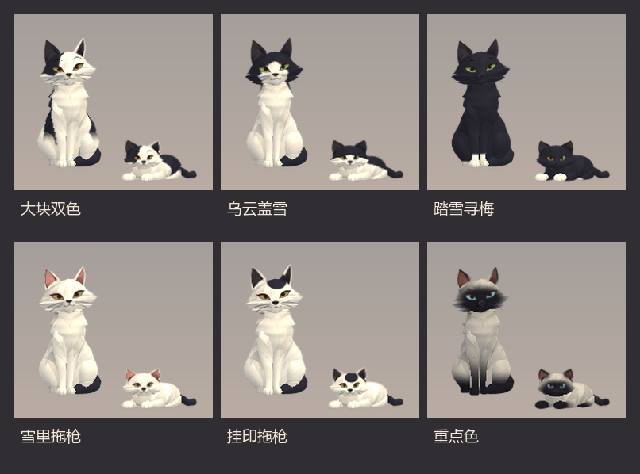

# 深空猫舍 · Deep Space Cattery

《深空当铺》（Probably Stolen）的猫咪养成模组。选择「宠物店」开局，你会带着一座装有喂食器的猫舍、一公一母两只成猫和四份猫粮来到当铺。晚上打烊后，猫可能捉老鼠、从废料堆拖回零件，也可能跑去拜访喜欢猫的邻居。



## 养猫与选育

- **繁育与家谱**　同一猫舍里的适龄公母猫有机会自然交配。子代从双亲继承基因，毛色、耳形、性格和窝产潜力都可能不同。双击任意一只猫可以查看性状和三代血亲。用基因扫描仪测序后，还能逐位对照母源与父源的 01 序列，紫框标出出生时发生突变的位置。
- **喂养与扩建**　猫粮能加快幼猫成长、延缓成猫衰老。用金属锭扩建猫窝，用韧棉织物建造独立繁育间。掉落的猫毛可以交给电池供电的加工器，每十份织成一份韧棉织物。
- **橱窗与交易**　把猫放在展柜里，开门时会引来爱猫人士。有的客人只想从小养幼猫，有的更喜欢稳重的老猫。也可以夜访宠物店，挑猫或购买用品，由店员送货上门。

## 从源码构建并安装

当前模组版本为 **0.2.62**，适配游戏 **0.46D**。在 Windows 上准备好已安装的游戏、PowerShell 和 .NET SDK。在仓库根目录运行以下命令，并将路径换成 Steam 中「管理 → 浏览本地文件」打开的游戏目录。

```powershell
$gameDir = 'C:\Program Files (x86)\Steam\steamapps\common\Probably Stolen'
.\tools\build-mod.ps1 -GameDirectory $gameDir
```

构建产物位于 `dist/DeepSpaceCattery/`。将整个 `DeepSpaceCattery` 文件夹复制到游戏的 `Mods/` 目录，确认 `Mods/DeepSpaceCattery/manifest.xml` 与 `DeepSpaceCattery.dll` 在同一层，再启动游戏，在模组菜单启用「深空猫舍」。

## 项目资料

- [玩法核心骨架](docs/玩法核心骨架.md)记录喂养、陪伴、夜行与交易的设计。
- [基因组设计](docs/猫猫基因组设计.md)和[表达规则](docs/猫猫基因表达规则.md)说明染色体结构、显隐性，以及多个位点如何共同决定性状。
- [开发与创意工坊发布](docs/开发与创意工坊发布.md)记录游戏接口、版本变更、构建和工坊打包步骤。

## 许可证

本项目采用 [MIT 许可证](LICENSE)。外观预览工具使用的 Three.js 随附[原作者的 MIT 版权声明](tools/cat-lab/vendor/THREE-LICENSE.txt)。
